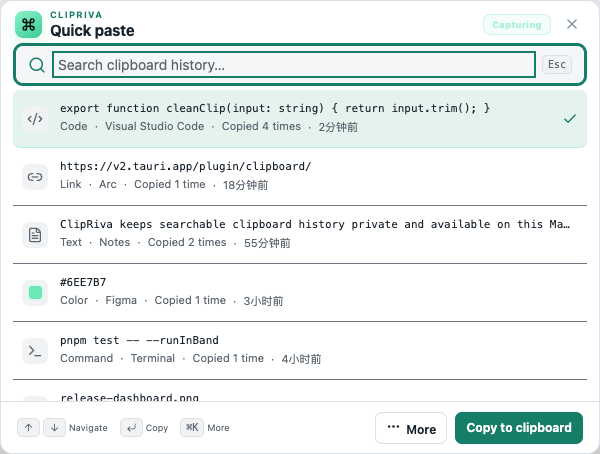
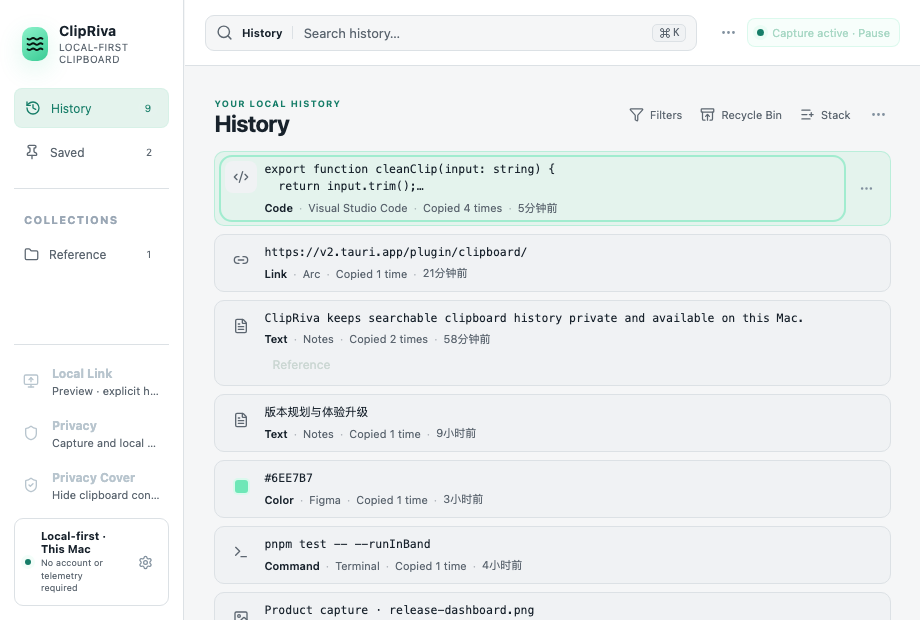

# ClipRiva

简体中文 | [English](README.md)

**找回并复用之前复制的内容。** ClipRiva 是面向 macOS 的剪贴板历史工具：复制两段文本，
唤出 Quick Paste，搜索较早的那段，按 Enter 将它恢复到系统剪贴板，再回到原应用用
`Command + V` 粘贴。

核心流程将 History 保留在你的 Mac 上，不需要账号或远程服务。你也可以在历史工作区
浏览复制过的文本、图片、富文本和文件引用。

## 公开源码预览

本仓库 [Sealdot/clipriva-source](https://github.com/Sealdot/clipriva-source) 公开的是
**源码和源码包**，不是稳定 App，也不是已签名、公证的安装包。

- [浏览当前源码](https://github.com/Sealdot/clipriva-source/tree/main)，或按下方开发路径运行。
  `main` 包含冻结预览之后的更新。
- [下载源码开发预览 1](https://github.com/Sealdot/clipriva-source/releases/tag/v2.0.0-alpha.1-source-preview.1)：
  应用版本为 `2.0.0-alpha.1`，源码提交为 `e4366664163ad51d2deb3276fb28ef4e1114b5dd`。
  Release 提供对应的源码 CI、下载校验、校验和与复现说明。
- 原生安装/UI、更完整的 macOS 真机兼容矩阵、签名公证及 Local Link 真实双 Mac 验收仍未验证。
  源码检查通过不代表这些结果已成立。

原生目标为 macOS 13+。冻结预览的源码 CI 使用 Apple Silicon 上的 macOS 14；
证据覆盖范围见 [macOS 支持政策](docs/macos-support.md)。

## 界面示例

**浏览器预览 · synthetic sample data（合成样本数据）· 非原生操作证明。** 两张图均为公开仓库
已有的项目自有 React 界面截图，未作修改。它们不证明系统剪贴板采集、全局快捷键、焦点返回
或双 Mac 传输已通过验证。

**Quick Paste：搜索较早内容，选择 Copy to clipboard。**



**历史工作区：浏览并整理需要复用的内容。**



截图上下文见 [Quick Paste 记录](docs/release/evidence/alpha2-cr02/README.md)、
[工作区记录](docs/release/evidence/alpha2-cr05/README.md)与
[素材来源](THIRD_PARTY_NOTICES.md#assets-and-system-components)。历史视觉记录与当前发布验收分别保留。

## 三个用户收益

- **找回被下一次复制覆盖的内容。** 用 Quick Paste 搜索和键盘选择，重新取回较早的那条。
- **让常用内容方便复用。** 用 History、Saved 和 Collections 整理片段；原生适配器也支持
  图片、富文本和文件引用。
- **决定哪些内容留在本机。** 暂停采集、排除应用、调整保留期限，清理前查看影响预览。
  本地存储仍然包含数据，使用敏感内容前请阅读 [PRIVACY.md](PRIVACY.md)。

## 首次使用：找回一段较早文本

按下方 macOS 路径启动原生开发应用后：

1. 完成首次引导，保持采集开启，使用默认的剪贴板恢复行为。
2. 在文本编辑器先复制 `Sample note: bring a notebook`，再复制
   `Sample note: confirm the room`，确认这两段普通样本文本都出现在 History。
3. 按 `Command + Shift + Space`（可在设置修改的默认快捷键）唤出 Quick Paste。
   搜索 `notebook`，用方向键选中较早样本。
4. 按 Enter。**预期结果：**较早样本恢复到系统剪贴板。回到编辑器，自行按
   `Command + V` 完成粘贴。

Enter 执行 Copy/恢复。**Direct Paste 是独立的可选动作**，需要 macOS 辅助功能权限，
会尝试返回目标应用并发送粘贴按键。目标应用不一定接受按键；权限或目标失败时可能降级为
剪贴板恢复。单纯恢复剪贴板不需要辅助功能权限。

若样本缺失，检查是否暂停采集、应用是否被排除及搜索词是否正确。
[首次使用与 FAQ](docs/help/v1.5-getting-started.md) 提供进一步排查说明。

### 获取源码，选择开发路径

使用当前公开分支时，在准备存放源码的目录运行：

```sh
git clone https://github.com/Sealdot/clipriva-source.git
cd clipriva-source
```

使用冻结源码包时，将[预览 Release](https://github.com/Sealdot/clipriva-source/releases/tag/v2.0.0-alpha.1-source-preview.1)
的五个附件下载到同一目录：`ClipRiva-source.tar.gz`、`SOURCE_RECORD.json`、`SHA256SUMS`、
`REPRODUCE.md`、`CI-evidence.zip`。在该下载目录运行：

```sh
shasum -a 256 -c SHA256SUMS
tar -xzf ClipRiva-source.tar.gz
cd ClipRiva-source
```

后续命令均在包含 `package.json` 和 `src-tauri/` 的源码根目录运行。以**所选检出版本自身**的
`.nvmrc`、`package.json` 中的 `packageManager`、`rust-toolchain.toml`、`pnpm-lock.yaml`
及 `src-tauri/Cargo.lock` 为准。当前 `main` 锁定 Node.js **24.15.0**、pnpm **11.9.0**、
Rust **1.97.1**。10 月 8 日冻结包早于后续依赖与运行时更新，请按包内 `REPRODUCE.md`
和版本声明复现，不要直接替换为当前版本。使用 `pnpm install --frozen-lockfile`，不要用
`npm install`。无需配置应用 `.env` 文件。

**路径 A：浏览器 UI 预览。** 安装所选版本的 Node.js 与 pnpm 后运行：

```sh
pnpm install --frozen-lockfile
pnpm dev
```

自行打开 [History：127.0.0.1:1420](http://127.0.0.1:1420/) 或
[Quick Paste 预览](http://127.0.0.1:1420/?quick-paste-preview)。
预期看到实际界面与内存中的 **synthetic sample data（合成样本数据）**，刷新后重置。
它不监控系统剪贴板，也不注册全局快捷键。Copy 可请求浏览器剪贴板写入，受浏览器权限约束；
模拟的原生和 Local Link 状态不构成 macOS 或双机验证。此路径不需要 Rust 或 Xcode。

**路径 B：macOS 原生开发。** 在 macOS 13+ 上安装 Xcode Command Line Tools
（尚未安装时运行 `xcode-select --install`）、所选 Node.js/pnpm，并通过 rustup 安装 Rust。
从源码根目录运行 Cargo 时，`rust-toolchain.toml` 会选择 Rust、rustfmt 和 Clippy。

```sh
pnpm install --frozen-lockfile
pnpm desktop:dev
```

预期 Tauri 编译并启动带原生剪贴板适配器的本地开发应用。此命令会打开应用窗口，
不构成安装包或签名公证验证。首次练习只使用普通合成文本。未签名构建说明与完整检查
见[开发指南](CONTRIBUTING.md)和[发布指南](docs/release.md)。

## 实验能力与数据处理限制

- **Labs 与本地自动化各自默认关闭。** 可选的本地摘要、检索、文本过滤及 CLI/Shortcuts
  能力属于实验功能。图片 OCR 需手动调用 macOS Vision。实现边界见
  [架构文档](docs/architecture.md)与[模块边界](docs/open-source/module-boundary.md)。
- **Local Link 默认关闭，仍为 Preview / No-Go。** 显式启用才启动本地网络发现与传输。
  它用于向已配对 Mac 显式交接**单条文本**，接收方选择 Copy（只写剪贴板）、Save
  （只写 History）或 Reject。它不是自动剪贴板镜像或历史同步，没有云中继或离线投递队列，
  真实双 Mac 验证尚未完成。完整要求见[证据门槛](docs/release/local-link-ga-evidence-gate.md)。
- **本地不等于不记录数据。** 历史及相关元数据保存在本地 SQLite/blobs，不宣称静态加密。
  可选诊断默认关闭；开启后保存有上限的事件/结果、日期和应用版本，排除剪贴板正文及
  身份识别字段。Privacy Activity 单独保留有上限的无正文采集原因，可能包含来源应用标签。
  详见[数据处理说明](PRIVACY.md)与[数据流](docs/privacy/data-flow.md)。
- **敏感内容检测有局限。** 检测到的高置信度秘密在入库前跳过；Strict 模式还会暂停后续采集，
  直到用户恢复。这不保证识别所有秘密。排除应用不会删除已有历史。Privacy Cover 隐藏界面，
  历史仍保留，未暂停时仍继续采集；它不是磁盘加密或系统级录屏阻断。

## 详细文档

| 主题 | 入口 |
| --- | --- |
| 开发、检查与贡献规则 | [贡献指南](CONTRIBUTING.md)、[变更规则](docs/development/open-source-change-rules.md) |
| Core、Labs、Local Link 实现 | [架构](docs/architecture.md)、[模块边界](docs/open-source/module-boundary.md)、[Local Link 协议](docs/local-link/PROTOCOL-v1.5.md) |
| 隐私与安全报告 | [隐私](PRIVACY.md)、[安全](SECURITY.md) |
| 源码验证与历史审计 | [公开预览记录](docs/audit/source-public-preview-2026-10-08.md)、[SBOM/许可审查](docs/audit/sbom-license-review.md) |
| 原生支持与发布门槛 | [macOS 支持](docs/macos-support.md)、[发布清单](docs/release/release-checklist.md)、[Local Link 验收](docs/release/local-link-ga-evidence-gate.md) |
| 产品方向与普通问题 | [路线图](ROADMAP.md)、[公开 Issues](https://github.com/Sealdot/clipriva-source/issues) |

代码采用 [Apache-2.0](LICENSE)。素材与品牌条件另见[第三方声明](THIRD_PARTY_NOTICES.md)
及 [ClipRiva 名称/标识政策](TRADEMARK.md)。
